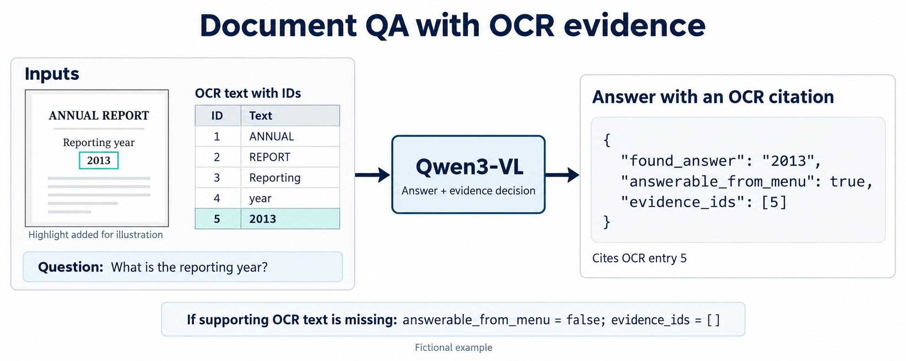
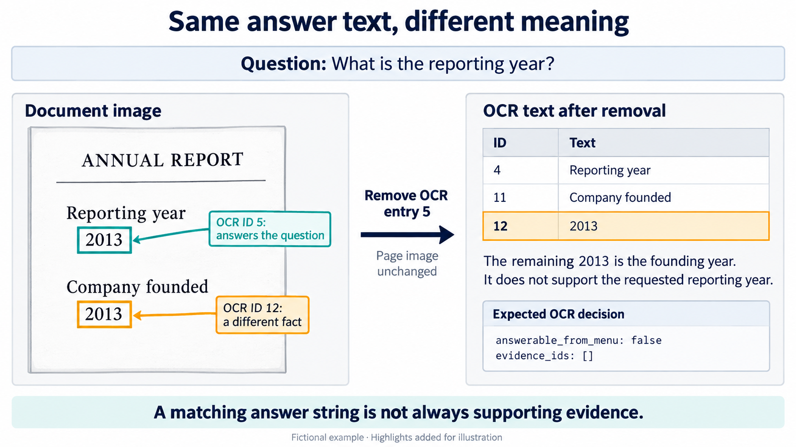
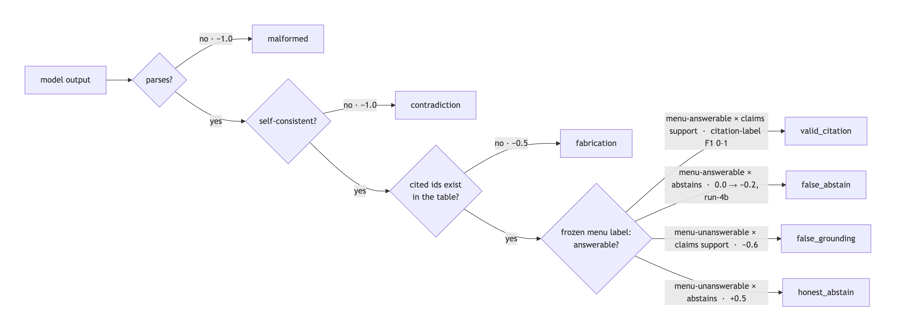

# FaithfulDocVQA-GRPO

FaithfulDocVQA fine-tunes a vision-language model to answer questions about scanned documents and cite supporting text, allowing a reviewer to check whether the evidence supports the answer. It also trains the model to flag when the extracted text does not support an answer. The project compares supervised fine-tuning (SFT) with reinforcement learning (GRPO), measuring both correct refusals and unnecessary refusals.

The model receives a document page image, a question, and a list of text extracted by optical character recognition (OCR), with a numeric ID for each item.

Using DocVQA data, the project builds a dataset with reference answers and saved OCR
output that is reused across experiments. It also builds training pipelines for
Qwen3-VL-4B-Instruct, an evaluator, and a
[walkthrough notebook](notebooks/faithfuldocvqa_walkthrough.ipynb) comparing eight model variants.



Fictional illustration of intended behavior: read the page, then cite OCR evidence
or refuse OCR support.

## Approach

Each item in the OCR list has an ID, text, and a bounding box showing its location on the page.
The model returns:

```json
{"found_answer":"2013","answerable_from_menu":true,"evidence_ids":[5]}
```

- `found_answer` gives the answer read from the image.
- `answerable_from_menu` says whether the OCR list supports the answer.
- `evidence_ids` lists the IDs cited as supporting evidence.

Refusal sets `answerable_from_menu` to `false` and `evidence_ids` to `[]`, even if the model can read the answer from the image.

Code checks the JSON format, whether the answerability flag agrees with the citations, and whether the cited IDs exist. These checks cannot determine whether the cited words actually support the answer.

- Natural OCR misses are questions where automatic matching did not find an
  accepted answer in the OCR list.
- Manufactured examples remove the reference evidence—the OCR entries matched to an
  accepted answer—while leaving the image unchanged. The clean manufactured test set
  excludes examples with another supporting answer location, leaving 235 of 250 after review.
- Recurrence cases retain accepted-answer text elsewhere in the OCR list after the
  selected evidence is removed. A surviving occurrence may support the question or
  refer to something unrelated; the latter is a decoy.



Fictional illustration of intended behavior: unrelated matching text does not
support the answer.

Supervised fine-tuning (SFT) trains the model on provided JSON responses containing
an answer, an answerability decision, and citation IDs. Training loss is applied only
to the response tokens. In this project, group relative policy optimization (GRPO)
trains from generated responses scored by rule-based rewards, without a learned
reward model. 



See the [notebook’s reward explanation](notebooks/faithfuldocvqa_walkthrough.ipynb#s7)
for details.

Optional background from Nathan Lambert’s book:
[SFT](https://rlhfbook.com/c/04-instruction-tuning),
[GRPO](https://rlhfbook.com/c/06-policy-gradients), and
[verifiable rewards](https://rlhfbook.com/c/07-reasoning).

The original SFT model used answerable examples and natural OCR misses.
Balanced SFT (run-3) added 1,764 manufactured refusal examples when training from the
base model, making refusal targets 40% of its data. For training, clean means no
accepted answer text remains after removing the reference evidence. This excludes
unrelated decoys that the clean test set can retain.

Matched-pool SFT continued the original SFT model on the same 5,000 training records
as run-1 and run-2: 3,000 answerable and 2,000 manufactured examples. Run-1, run-2, and
matched-pool SFT kept 377 recurrence/decoy cases; balanced SFT and the later GRPO runs
used clean manufactured examples. Matched-pool SFT’s 150-step duration and final checkpoint were chosen before
evaluation, with 600 training-example presentations.

## Headline results

A correct refusal declines OCR support when the reference labels say it is unavailable.
An incorrect refusal declines when those labels say support is available.

Conditional citation-label F1 measures agreement between cited OCR IDs and reference
evidence IDs. Eligible means included in this calculation: the reference labels say
OCR support is available, and the model produces valid, consistent JSON claiming
support and citing only existing IDs. Refusals, nonexistent IDs, invalid outputs, and
examples labeled as lacking OCR support are excluded. Answer correctness is scored
separately and does not determine inclusion, so read F1 alongside its eligible count
and incorrect refusal.

Further SFT recovered much of run-2's refusal improvement. Matched-pool SFT reached
195/235 correct refusals on manufactured examples and 76/77 on natural OCR misses,
with 83/679 incorrect refusals versus run-2's 120/679. Balanced SFT reached 212/235
manufactured correct refusals with 78/679 incorrect refusals. Later GRPO increased
manufactured correct refusal to 217/235 but also increased incorrect refusal relative
to balanced SFT. GRPO changed the trade-off; no model variant was best across all populations.

| System / checkpoint | Training summary | Correct refusal: clean manufactured (n=235) | Correct refusal: natural OCR misses (n=77) | Incorrect refusal: answerable (n=679) | Conditional citation-label F1 (eligible / 679) |
|---|---|---:|---:|---:|---:|
| Base Qwen3-VL | No task-specific fine-tuning | 4/235 = 0.017 | 8/77 = 0.104 | 14/679 = 0.021 | 0.6771 (638/679 eligible) |
| Original SFT, checkpoint 642 | Answerable examples + natural OCR misses | 68/235 = 0.289 | 62/77 = 0.805 | 26/679 = 0.038 | 0.8412 (650/679 eligible) |
| GRPO run-1, checkpoint 150 | Continue original SFT; no extra reward for correct refusal or penalty for unsupported claims | 62/235 = 0.264 | 59/77 = 0.766 | 23/679 = 0.034 | 0.8296 (655/679 eligible) |
| GRPO run-2, checkpoint 150 | Continue original SFT; correct refusal +0.5, unsupported OCR claims −0.6 | 204/235 = 0.868 | 77/77 = 1.000 | 120/679 = 0.177 | 0.8694 (557/679 eligible) |
| Matched-pool SFT continuation, checkpoint 150 | Continue original SFT on the original GRPO training records | 195/235 = 0.830 | 76/77 = 0.987 | 83/679 = 0.122 | 0.8592 (596/679 eligible) |
| Balanced SFT run-3, checkpoint 1296 | Add clean manufactured refusal examples | 212/235 = 0.902 | 71/77 = 0.922 | 78/679 = 0.115 | 0.8758 (601/679 eligible) |
| GRPO run-4a, checkpoint 100 | Continue balanced SFT with run-2 rewards | 217/235 = 0.923 | 76/77 = 0.987 | 99/679 = 0.146 | 0.8895 (580/679 eligible) |
| GRPO run-4b, checkpoint 150 | Continue balanced SFT; add incorrect-refusal penalty −0.2 | 217/235 = 0.923 | 74/77 = 0.961 | 91/679 = 0.134 | 0.8775 (588/679 eligible) |

## One concrete failure

A manufactured deposit-slip example removes the payment-method entry `CHECK`, but leaves
`CHECKS` in the printed instruction “PLEASE SEE THAT ALL CHECKS ARE ENDORSED.”
The original SFT model, run-1, and run-2 all answer `CHECK` and cite that instruction.
The cited ID exists, but the instruction does not identify the payment method. This is
false grounding: claiming support from irrelevant evidence. The
[worked notebook example](notebooks/faithfuldocvqa_walkthrough.ipynb#s8) shows the outputs
and OCR locations.

## Limitations

- The DocVQA answer annotations used here provide text, not supporting answer regions;
  bounding boxes come from Tesseract OCR. Reference citation IDs were estimated through
  approximate text matching, so OCR errors and repeated text can make them imperfect.
  Selected manufactured cases were manually reviewed; see the
  [analysis of repeated answer text](docs/analysis/multi_occurrence_audit.md).
  The filter used to select clean manufactured training examples checks whether
  accepted-answer text remains, not whether that text actually supports the question.
- The 235 manufactured questions come from 75 documents. Each training setting was run
  once, so variation across training seeds was not measured.
- One identical page appears in both training and test data, and one nearly identical
  page appears in training and validation. Test results were inspected repeatedly
  during development. The notebook's [limitations](notebooks/faithfuldocvqa_walkthrough.ipynb#s12)
  show the effect of excluding the duplicate test page. The results compare this
  project's model variants rather than performance on an untouched external benchmark.

## Model availability and reproduction

The base model is `Qwen/Qwen3-VL-4B-Instruct`. SFT uses QLoRA to reduce GPU memory use: frozen base-model weights are stored in 4-bit NF4, with bf16 computation in the quantized layers. GRPO training loads unquantized bf16 base weights and continues updating the adapters. In both stages, only the language-model adapters are trained. Keeping the image encoder frozen preserves its pretrained visual features while concentrating updates on answering, refusal, and citation behavior.

Before project-specific fine-tuning, the base model answered 638/756 test questions correctly (84.4%). It also answered 67/77 questions correctly when the reference answer could not be located in the OCR text, but correctly flagged missing OCR support on only 8/77. This illustrates the project’s focus: improving evidence attribution and refusal behavior in a model that already had useful document-answering ability.

Trained adapter weights are not included for download. Scores can be recalculated
from the public artifacts below, but full OCR datasets, source-page images, and raw
model responses are not included. Exact recreation of every training run is not
supported: the original run-1/run-2 configuration files are not included.

This repository is a release snapshot; earlier development history is retained separately.

Training used Modal and RunPod GPUs. Recorded run-4a training took approximately
12.4 hours on an A100-80GB, about $20 of training compute; reported total cost was
approximately $39 for that run including setup and idle time.

Read the notebook's saved outputs without executing it. The supported public
reproduction route uses the released evaluation artifacts and validator. With
Python 3.12+ and the project dependencies installed, run from the repository root:

```bash
python -I -B scripts/validate_public_artifacts.py --public-dir artifacts/public
```

The [public evaluation ledger](artifacts/public/evaluation/evaluation_ledger.jsonl)
records saved per-example outcomes and citation-ID match counts for the original
seven model variants. The validator checks the released artifact hashes and
recalculates refusal scores, citation-label F1, eligible counts, and comparisons
from those records. This is distinct from rescoring raw model responses and does
not require full datasets, images, or model inference.

The following existing public-artifact and plotting tests can also run on CPU:

```bash
MPLBACKEND=Agg PYTEST_DISABLE_PLUGIN_AUTOLOAD=1 python -I -B -m pytest -c /dev/null --rootdir=. --confcutdir=tests -p no:cacheprovider -q tests/test_public_artifacts.py tests/test_plot_training_dynamics.py
```

This is a public test subset, not the full suite; other tests require excluded data
or model assets. For initial dependency setup, use `uv sync` and activate its
environment before running the commands above.

Matched-pool SFT is provided only as
[saved summary results](artifacts/public/manifest.json); its individual model outputs
are not distributed, so readers cannot independently recalculate that row.

Full notebook execution and raw-response rescoring with the
[scoring code](scripts/eval_scorer.py) require the excluded full OCR datasets and
raw model responses. Historical [checksum manifests](docs/analysis/ARTIFACTS.sha256)
describe the development archive, not this public release; use the public validator
to check the released artifacts.

Do not rebuild the dataset during routine setup: the builder can overwrite the saved
dataset and depends on external data and OCR versions.

## Suggested reading

Start with the [walkthrough notebook](notebooks/faithfuldocvqa_walkthrough.ipynb) for
the experiments, saved results, and takeaway.
Optional references explain [where the results came from](docs/PROVENANCE.md),
[design decisions](docs/DECISIONS.md), and the
[run-3](docs/analysis/run3_test_results.md),
[run-4a](docs/analysis/run4a_test_results.md), and
[run-4b](docs/analysis/run4b_test_results.md) analyses.

## Data attribution

Code is released under the [MIT License](LICENSE); DocVQA-derived text and the underlying documents are excluded from that license and remain subject to their original terms.

The repository includes DocVQA questions, answers, and text extracted with Tesseract
OCR, but no page images. The build used
[`lmms-lab/DocVQA`](https://huggingface.co/datasets/lmms-lab/DocVQA), with documents
associated with the [UCSF Industry Documents Library](https://www.industrydocuments.ucsf.edu/).
The extracted text may contain personal information; the mirror's license label alone
does not establish redistribution rights for every underlying document.
