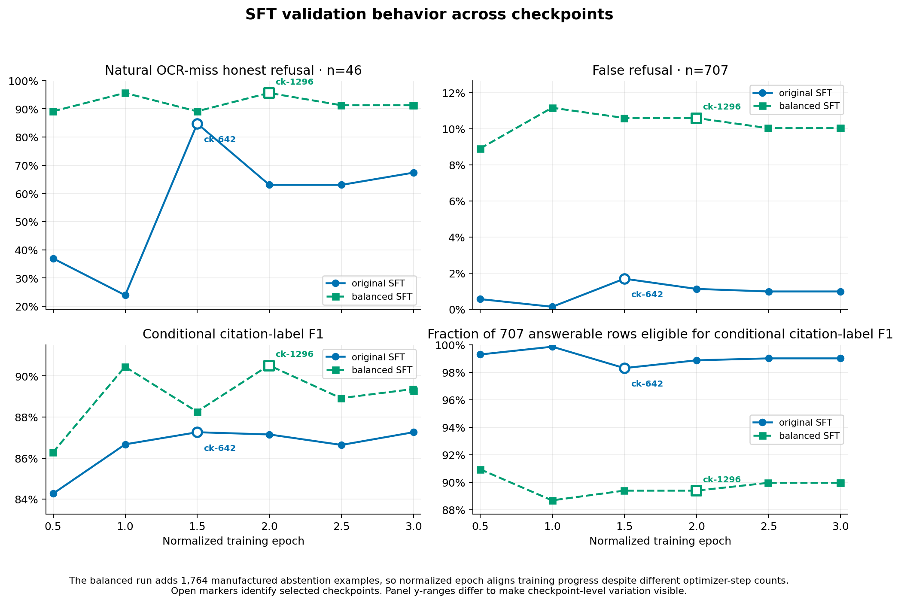
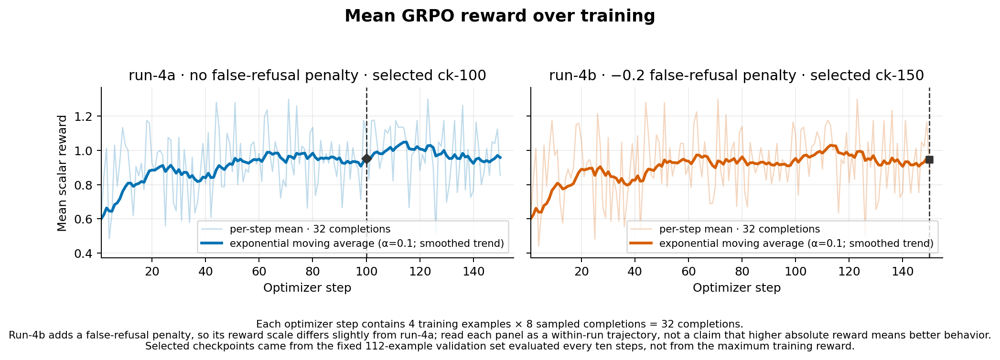
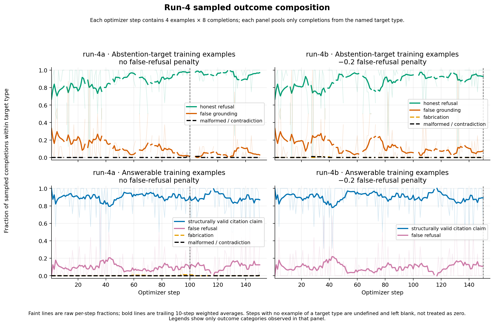
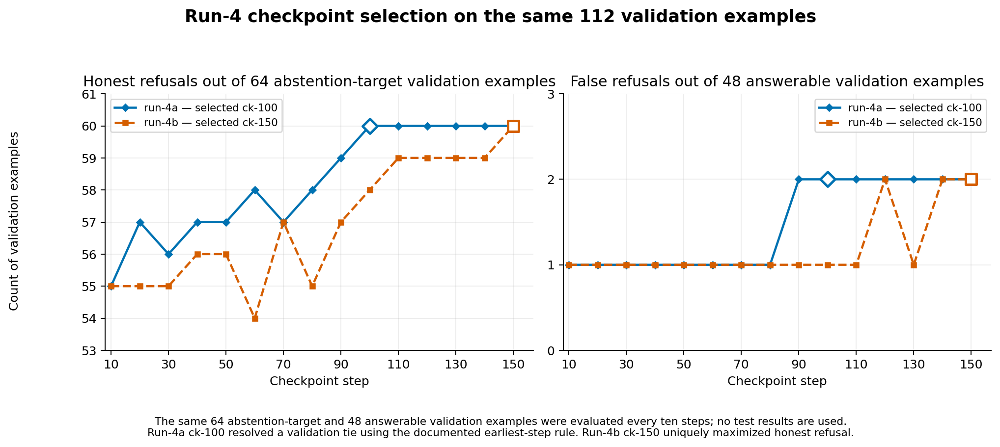
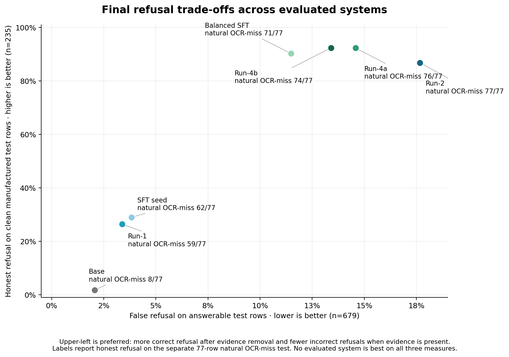

# Figure Provenance

The analysis plots described below are generated by `scripts/plot_training_dynamics.py`.
The script recomputes evaluation metrics with the canonical scorer and verifies every used
artifact covered by `docs/analysis/ARTIFACTS.sha256` before plotting it.

The fictional README illustrations, `docqa_overview.jpg` and
`ocr_recurrence_example.png`, are separate assets and are not generated by this script.

## SFT validation behavior across checkpoints



- **Purpose:** Compare how the original and balanced supervised-training variants behave across checkpoints.
- **Sources:** The six validation generations in `data/checkpoints/eval/sft_B_seed42/`, the seven validation generations in `data/checkpoints/eval/sft_v3_balanced_nodecoy/`, `data/master.jsonl`, `data/manufactured_train_abstains_nodecoy.jsonl`, and both archived SFT configurations in `docs/run_configs/`.
- **Population:** The fixed validation split: 46 natural OCR-miss rows and 707 menu-answerable rows.
- **Split use:** Validation only; no test generation contributes to the curves.
- **Interpretation:** The balanced run adds 1,764 manufactured abstention examples, so it contains more optimizer steps; normalized epoch aligns training progress. Open markers show the selected checkpoints. Panel y-ranges differ to make checkpoint-level variation visible, and conditional citation-label F1 should be read with its eligible coverage.
- **Reproduce:** `uv run python scripts/plot_training_dynamics.py --figure sft_checkpoint_behavior --out-dir docs/figures`

## Mean GRPO reward over training



- **Purpose:** Show the per-step mean scalar reward and committed exponential moving average for run-4a and run-4b.
- **Sources:** `reward_log.jsonl` and `grpo_run_config.json` under `data/checkpoints/grpo_run4a_seed42/` and `data/checkpoints/grpo_run4b_seed42/`.
- **Population:** Each of 150 optimizer steps contains four training examples with eight sampled completions each, for 32 completions per step.
- **Split use:** Training telemetry only.
- **Interpretation:** The exponential moving average uses α=0.1 and shows the smoothed within-run trend while the faint line retains every raw step mean. Run-4b adds a false-refusal penalty, so its numeric reward scale differs slightly from run-4a; higher absolute reward is not evidence of better behavior. Selected checkpoints came from the fixed 112-example validation set evaluated every ten steps, not from maximum training reward. `reward_std` is not shown as uncertainty.
- **Reproduce:** `uv run python scripts/plot_training_dynamics.py --figure run4_reward_dynamics --out-dir docs/figures`

## Run-4 sampled outcome dynamics



- **Purpose:** Show whether sampled training outcomes shift toward honest refusal, false grounding, false refusal, or structurally valid citation behavior.
- **Sources:** `reward_members.jsonl`, `reward_log.jsonl`, and `grpo_run_config.json` under both run-4 checkpoint directories.
- **Population:** The 4,800 committed sampled completions per run. Each optimizer step contains four training examples with eight completions each; panels pool only the completions from the named target type.
- **Split use:** Training samples only.
- **Interpretation:** Bold lines are trailing ten-step weighted averages over within-target denominators, and faint lines retain raw per-step fractions. Some steps contain no example of one target type; those fractions are undefined and left blank rather than treated as zero. Legends show only categories observed in that panel, so an omitted category had zero observed occurrences there. A structurally valid citation claim is not a semantic-correctness judgment.
- **Reproduce:** `uv run python scripts/plot_training_dynamics.py --figure run4_outcome_dynamics --out-dir docs/figures`

## Run-4 checkpoint selection on the same 112 validation examples



- **Purpose:** Compare honest- and false-refusal counts across run-4 checkpoints on the instrument used for checkpoint selection.
- **Sources:** The exact `eval_step10.jsonl` through `eval_step150.jsonl` sequence for each run, `data/grpo_val_instrument_v2_recursfalse.jsonl`, `data/manufactured_val_abstains.jsonl`, and `data/master.jsonl`.
- **Population:** The same 112 validation examples at every checkpoint: 64 clean manufactured abstention targets and 48 answerable examples.
- **Split use:** These examples were held out from training but evaluated repeatedly every ten steps for checkpoint selection; they are not an untouched test set, and no test generation contributes to the curves.
- **Selection:** Run-4a reached 60/64 honest refusals at steps 100–150, with all six tied at 2/48 false refusals; the documented earliest-step rule selected ck-100. Run-4b uniquely reached 60/64 honest refusals at ck-150, so the primary selection criterion resolved without a tie-break; it also had 2/48 false refusals.
- **Stable citation-label measures:** Conditional citation-label F1 ranged from 0.9291–0.9446 for run-4a and 0.9324–0.9446 for run-4b. Eligible coverage ranged from 46/48 to 47/48 for both runs. These conditional measures remained comparatively stable while refusal counts moved, so they are recorded here rather than occupying two additional figure panels.
- **Reproduce:** `uv run python scripts/plot_training_dynamics.py --figure run4_validation_dynamics --out-dir docs/figures`

## Final refusal trade-offs across evaluated systems



- **Purpose:** Compare the refusal tradeoff at the final named checkpoint for the original seven model variants.
- **Sources:** Each system's committed selected-checkpoint natural-test and manufactured-test generation artifacts, `data/master.jsonl`, and `data/manufactured_test_abstains.jsonl`.
- **Population:** 679 answerable natural-test rows, 77 natural OCR-miss rows, and the clean 235-row manufactured instrument.
- **Split use:** Final test evaluation only; no checkpoint curve is derived from test data.
- **Interpretation:** Upper-left is preferred: more correct refusal after evidence removal and fewer incorrect refusals when evidence is present. Labels report honest refusal on the separate 77-row natural OCR-miss test. No evaluated system is best on all three measures.
- **Reproduce:** `uv run python scripts/plot_training_dynamics.py --figure final_operating_points --out-dir docs/figures`

## Reproduce all approved figures

```bash
uv run python scripts/plot_training_dynamics.py \
  --figure all \
  --out-dir docs/figures
```
